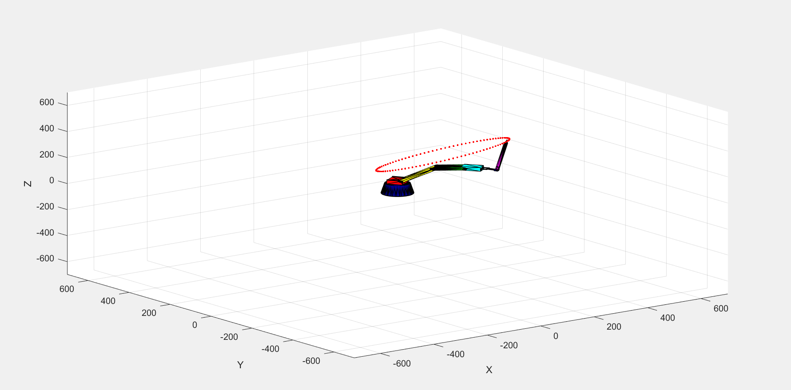
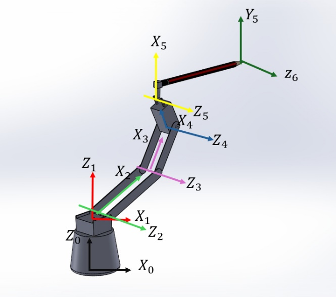
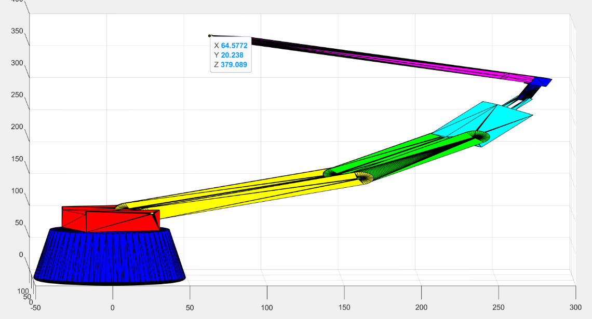

# 5-DOF Robot Arm: Kinematics in MATLAB

Final project for an *Introduction to Robotics* course. A 5-DOF pen-holding robot arm is modelled with
Denavit-Hartenberg parameters. The code solves its forward and inverse kinematics and animates the arm
(from SolidWorks STL models) while the pen traces an ellipse in space.



## What's inside

| File | What it does |
|---|---|
| `forward_kinematics.mlx` | Symbolic forward kinematics: builds `T06` from the DH table (Live Script) |
| `ik_single_point.m` | Inverse kinematics for one target point and pen direction (`lsqnonlin`) |
| `ik_ellipse.m` | Generates 101 points on a tilted ellipse and solves the joint angles for each one |
| `animate_robot.m` | Animates the STL model of the arm following the solved joint angles |
| `models/` | STL parts of the arm exported from SolidWorks (base, links, wrist, pencil) |
| `images/` | Coordinate frames of the arm and result plots |

## DH table (mm / degrees)

| i | a(i-1) | alpha(i-1) | d(i) | theta(i) |
|---|---|---|---|---|
| 1 | 0 | 0 | 107 | theta1 |
| 2 | 20 | 90 | 0 | theta2 |
| 3 | 150 | 0 | 0 | theta3 |
| 4 | 100 | 0 | 0 | theta4 |
| 5 | 68.5 | 0 | 0 | theta5 |
| 6 (pen) | 29 | -90 | 239 | 0 |



## How it works

1. `DH(a, alpha, d, theta)` builds one homogeneous transform, and multiplying all six gives the pen pose `T06`.
2. The inverse problem is solved numerically: `lsqnonlin` finds the 5 joint angles that put the pen tip at the
   target point **and** point the pen along the requested direction. The joint limits are given as bounds.
3. For the ellipse, each of the 101 points is rotated in space (`rotx`, `roty`, `rotz`) and solved in turn.



## Run it

Requirements: MATLAB with the Symbolic Math Toolbox and Optimization Toolbox. `rotx/roty/rotz` come from
the Robotics System Toolbox (or Navigation Toolbox), and `stlread` is built in.

```matlab
ik_ellipse      % solves all joint angles (slow: symbolic substitution on every iteration)
animate_robot   % animates the arm (needs the variables created above)
```

Run both from the repository root so that `models/` is found. `ik_single_point` and
`forward_kinematics.mlx` run on their own.

## Notes

- Angles are in degrees and lengths in millimetres.
- The solver uses a numerical optimizer with a zero initial guess, so very different targets might need a
  better starting point.
- Course material (assignment text, report) is not included.

## License

MIT, see [LICENSE](LICENSE).
